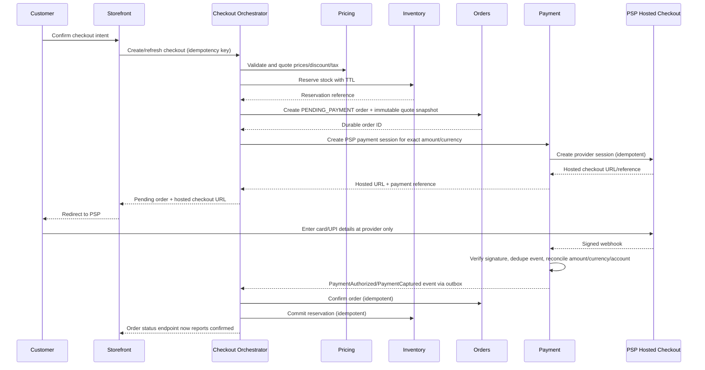

# Checkout, Order and Payment Saga

# Part E — Checkout, Order and Payment Saga

# Checkout, order and payment saga

## State ownership

- Checkout Orchestrator owns the durable workflow state and correlation/idempotency key.
- Inventory owns stock quantity and reservation state.
- Orders owns order identity, immutable purchase snapshots and order lifecycle.
- Payment owns PSP interaction, provider webhook inbox and payment/refund state.
- No service reaches into another service's database.

## Happy-path sequence

## Failure handling matrix

| Situation | Durable action | Compensation / operator action |
|---|---|---|
| Cart/price/stock invalid before payment | Do not create PSP session | Requote/reject and tell customer what changed |
| Payment failure/cancel | Mark payment attempt failed; order pending/failed per state machine | Release stock reservation; allow a new idempotent attempt |
| Duplicate webhook | Record provider event ID and return successful acknowledgement | No duplicate state transition/refund/order |
| Webhook delayed/out-of-order | Store event and evaluate legal state transition | Reconcile with PSP server-to-server |
| PSP confirms but Orders temporarily unavailable | Keep saga pending and retry | Alert after retry budget; reconcile, do not falsely mark paid/failed |
| Reservation expires but payment succeeds | Saga detects expired reservation | Try safe re-reservation; otherwise void/refund and manual review |
| Inventory commit fails after payment | Keep order/payment state explicit | Retry; if fulfillment impossible, void/refund and alert |
| Refund/void provider call fails | Refund stays pending | Retry idempotently and provide operator reconciliation |

## Required invariants

- Client redirect is never authoritative payment confirmation.
- Amount, currency, provider account and order reference are checked server-side.
- One logical checkout/payment/order command is idempotent.
- PSP webhooks are signature-verified, deduplicated and safely handled out of order.
- Outbox record is committed atomically with the owning service's state.
- Consumers use inbox/deduplication records and are idempotent.
- No database transaction is held open during a network call to a PSP/carrier.
- PAN/CVV never enter the platform, its databases, logs, events, cache or traces.
- State transitions and compensation attempts are auditable and visible to operators.

The provider-specific details of authorize/capture/void/refund must be confirmed for the chosen PSP in its sandbox and documented in the Payment ADR before live processing.

---
