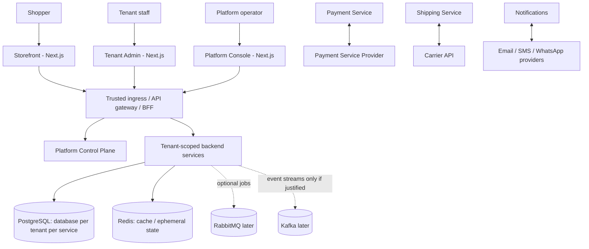
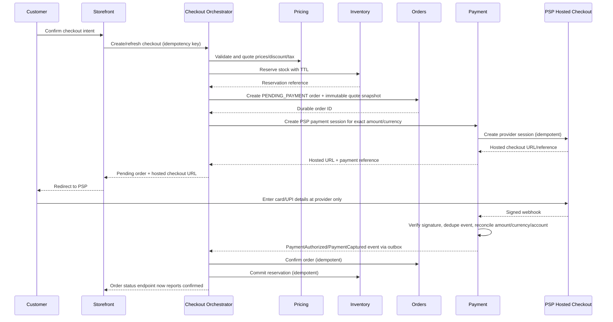

# Commerce SaaS Platform
## Phase 0 Architecture Baseline & Phase 1 Delivery Blueprint

**Platform identity:** Generic white-label, multi-tenant commerce SaaS  
**Example tenant:** Lifemac Pharma (tenant one only)  
**Prepared:** 16 November 2026  
**Status:** Technical baseline prepared; human sign-off and listed business/compliance decisions remain open  
**Repository:** `commerce-saas-platform/`  

> This document is a practical engineering blueprint. It is not a claim that production code has been implemented, that the system is vulnerability-free, or that any legal/PCI/regulatory certification has been achieved. Execute local Phase 1A first; only proceed to Phase 1B after the local checks pass and the user approves.

## Start sequence

1. Read root `AGENTS.md` and `docs/product/PRD.md`.
2. Review the controlling Phase 0 baseline and open decision register.
3. Run Phase 1A: create local `.env`, validate Compose and start only PostgreSQL, Redis and Mailpit.
4. Verify container health, ACLs and Git ignore rules on the developer machine.
5. Run the Phase 1B Codex prompt to design and implement only the Platform Control Plane.
6. Stop for human review before Identity & Access or any other service.

## Key architecture rules

- Generic platform; no Lifemac-specific hardcoding.
- Separate `frontend/` and `backend/` workspaces.
- Independently maintained backend microservices in one monorepo.
- Database-per-tenant-per-service; platform control database contains metadata only.
- PostgreSQL `PUBLIC` cannot connect to tenant databases; grant DB access only to the owning service's runtime/migrator roles.
- Privileged provisioning worker creates DBs/roles and secret references; owning services run their own migrations.
- PSP-hosted payment collection; PAN/CVV never enters the platform.
- Small local Compose profile first; RabbitMQ optional, Kafka deferred.
- AI and hosting/EC2 are later phases. A single EC2 is a pilot, not HA.

---

# Part A — Phase 0 Architecture Baseline

## 1. Executive decision

Build a generic white-label, multi-tenant commerce SaaS platform. A new business is onboarded through platform configuration, not a code fork. Each tenant receives its own brand, domain, products, customer accounts, orders, inventory, business settings, payment-provider configuration and staff access. The platform operator has a separate control plane.

The repository is a monorepo with **separate `frontend/` and `backend/` roots**. The three frontend applications are independently runnable apps. Each backend microservice is an independently structured application with its own dependencies, lockfile, migrations, database credentials, tests, Dockerfile and release boundary. Shared code is limited to versioned contracts and small technical libraries; domain models and database repositories are never shared across service boundaries.

Tenant commerce data uses **database-per-tenant-per-service**. Databases are provisioned lazily for enabled tenant/service pairs rather than pre-creating all 15 databases for every tenant. A single local PostgreSQL container may host many logical databases, but there is no shared tenant commerce database or cross-service SQL access. The control-plane database stores only platform metadata and provisioning references.

Initial local infrastructure is deliberately small: PostgreSQL, Redis and Mailpit. RabbitMQ is optional when a real background-job requirement arrives. Kafka is deferred until replayable/high-volume event streaming is justified by a reviewed ADR. No cloud resources or AI features are required for Phase 1A.

## 2. Goals, non-goals and actors

### Goals

- Onboard multiple businesses without separate codebases.
- Provide a premium responsive storefront, tenant-admin app and platform-console app.
- Isolate tenant data and tenant payment-provider credentials.
- Support a full commerce lifecycle: catalogue, pricing, inventory, cart, checkout, payment, order, fulfilment, returns and customer communications.
- Operate each backend service independently inside one monorepo.
- Keep local development reproducible and light enough to run only the required dependencies.
- Preserve a container/configuration boundary that can later be moved to EC2.
- Add RAG, product discovery and AI agents only after core commerce is stable and approved.

### Non-goals for initial local development

- Public multi-vendor marketplace or platform-operated split settlements.
- AI diagnosis, medical advice, prescriptions or autonomous medical claims.
- Mobile-native applications (responsive web first).
- Azure/cloud dependency, production hosting or public ingress.
- Storing raw card numbers, CVV/CVC, PIN or track data.
- A claim of zero vulnerabilities or automatic legal/PCI/regulatory compliance.

### Actors

| Actor | Scope |
|---|---|
| Shopper/customer | One tenant storefront and that tenant's customer identity |
| Tenant owner/admin/staff | One or more explicit tenant memberships and least-privilege roles |
| Platform operator | Tenant onboarding, plans, domain and provisioning lifecycle; no unrestricted business-data access by default |
| Platform security/operator admin | Platform-level identity, privileged audited actions and break-glass support controls |
| External PSP/carrier/communication provider | Narrow provider APIs and signed webhooks |

## 3. Selected technology baseline

Versions below are a reproducible starting baseline checked on 16 November 2026. Before implementation, review current patch releases and compatibility; commit lockfiles and image digests where practical. Do not use floating `latest` tags in the repository.

| Layer | Selected baseline | Rule |
|---|---|---|
| Frontend | Next.js App Router, React, TypeScript strict | Three separate apps; no business source-of-truth logic in UI |
| Frontend workspace | pnpm workspaces + Turborepo | Frontend-only workspace; pin actual package manager via `packageManager` and lockfile during scaffold |
| UI | Tailwind CSS, Radix/shadcn primitives, Motion | Accessible design system and tenant design tokens |
| Frontend data/forms | TanStack Query, React Hook Form, Zod | Use server components for read-heavy public pages where appropriate |
| Frontend test | Vitest, Testing Library, Playwright, Storybook | Unit, interaction, E2E and visual review |
| Backend | Python 3.14.10, FastAPI, Pydantic v2 | Python 3.14 bug-fix line; pin exact patch in `.python-version` and service image |
| Backend packages | SQLAlchemy 2, Psycopg 3, Alembic, `uv` | Each service owns its `pyproject.toml`, `uv.lock` and migrations |
| Backend quality | Pytest, Ruff, MyPy or Pyright | Strict typing, lint and tests in CI |
| Primary data | PostgreSQL 18.7 | Logical database per tenant per service; separate runtime/migrator credentials |
| Cache | Redis 8.10.3 | Cache/ephemeral state only, never authoritative price/order/payment/inventory data |
| Local email | Mailpit 1.33.1 | Capture SMTP locally; no real customer messages |
| Background jobs | RabbitMQ 4.4.0 optional Compose profile | Introduce only with a concrete queue consumer/retry requirement |
| Event streaming | Apache Kafka 4.4.0 later optional profile | Deferred; not the default local dependency or generic job queue |
| Local runtime | Docker Compose | Dependencies only initially; apps can run on host during service development |
| API contracts | REST/JSON + OpenAPI 3.1 | Version public APIs (e.g. `/api/v1`); internal contracts backward-compatible |
| Observability | Structured logs first; OpenTelemetry instrumentation planned | Never log PII, tokens, OTPs, PAN/CVV or provider secrets |

**Runtime policy:** use Node.js 26 Active LTS (26.x) and Python 3.14 bug-fix (3.14.x) as project baselines. Use the exact versions in `.nvmrc`/`.node-version`, `.python-version`, container build files and CI once the first app/service is scaffolded. Avoid preview/alpha runtimes for the initial product.

### Why this stack

Next.js provides server rendering and SEO support for product pages while TypeScript helps make the multi-app frontend maintainable. FastAPI/Pydantic fit the Python backend and later RAG/agent workloads without forcing AI code into commerce services. PostgreSQL is the transactional system of record. Redis is a performance/ephemeral layer. Compose keeps local dependencies reproducible. Service boundaries, not the language, provide independent ownership.

## 4. System context and application boundaries



### Frontend ownership

| App | Owns | Must not do |
|---|---|---|
| `frontend/apps/storefront` | Public catalogue, product pages, customer account UI, cart/checkout UI, order tracking | Connect to databases, calculate authoritative prices, decide stock, mark payments complete |
| `frontend/apps/tenant-admin` | Tenant products, inventory, orders, promotions, staff and configuration UI | Access another tenant, bypass backend policies or contain platform-super-admin privileges |
| `frontend/apps/platform-console` | Tenant onboarding/lifecycle, plans/entitlements, verified domains, provisioning status and platform operations | Read customer card data or directly mutate tenant-owned databases |

Shared frontend packages should contain neutral UI primitives, design tokens, typed generated API clients and test utilities only. Theme and brand data come from validated tenant configuration. Do not execute tenant-provided JavaScript or arbitrary CSS.

## 5. Service boundaries and data ownership

Every service has its own database per tenant where it owns tenant business data. The platform control-plane database is global and metadata-only. Platform-level operator identities belong to a platform-scoped identity database owned by Identity & Access, separate from tenant customer/staff identity databases.

| Service | Source-of-truth data | Explicitly does not own |
|---|---|---|
| Platform Control Plane | Tenant registry, domains, status, plans/entitlements, provisioning jobs and database/secret references | Tenant products, customers, carts, orders, payment transactions |
| Identity & Access | Platform operator identities in platform scope; customer/staff identities, credentials, sessions, memberships and consent per tenant | Products, orders, payment methods |
| Catalogue | Product master, categories, variants, attributes, product content and publication status | Prices, inventory, orders |
| Media | Asset metadata, ownership, processing state and safe storage references | Executable content or card images/data |
| Pricing & Promotions | Price lists, price rules, coupons and promotion evaluation | Product master, stock or payment transactions |
| Inventory | Warehouses, stock, batch/lot, expiry, movements, reservations | Order/payment source records |
| Cart | Guest/authenticated cart, cart lines and wishlist | Final order or payment status |
| Orders | Order aggregate, immutable line/tax/price snapshots, order state and cancellation/return references | Payment credentials or inventory source tables |
| Payment | PSP account references, payment intents/attempts, provider event inbox, refunds and reconciliation | Raw PAN/CVV or order master |
| Checkout Orchestrator | Checkout quote snapshot, saga state, idempotency and cross-service workflow | Product/inventory source tables or card data |
| Shipping & Fulfilment | Shipment, label reference, tracking and delivery state | Full order source of truth |
| Notifications | Templates, consent/preferences references, delivery attempts and provider adapters | Passwords/auth secrets or payment credentials |
| Search & Discovery | Derived tenant search documents/index metadata | Authoritative product records |
| Reviews & Content | Reviews, ratings, Q&A and moderation state | Identity credentials or order source tables |
| Analytics & Reporting | Minimized, derived reporting data | Authoritative commerce state |

A service may store a minimal immutable snapshot or external reference needed for its own aggregate. Cross-service IDs are references, not relational foreign keys into another service's database. There are no cross-database SQL joins, shared ORM entities or direct cross-service DB reads/writes.

## 6. Tenant resolution and authorization

Tenant context and user authorization are distinct. Knowing a tenant does not grant a user access to that tenant.

1. A trusted ingress terminates the client connection and normalizes the host. It strips client-supplied forwarding/tenant headers and writes its own trusted routing metadata.
2. The host is normalized and matched against an active, verified `tenant_domains` record. New custom domains require a domain-ownership challenge (DNS TXT or an equally strong documented method) before activation.
3. The platform control plane checks tenant lifecycle state and returns a short-lived signed tenant context to trusted backend components. The browser never receives a signing key.
4. Internal tenant context is signed asymmetrically and includes at minimum issuer, audience, tenant opaque ID, normalized domain, issued-at, expiry, key ID and correlation ID. Services verify signature, issuer, audience, expiry and tenant status. Keys support rotation and overlap.
5. Service-to-service caller identity is authenticated separately (short-lived audience-specific service credentials; mTLS is a production hardening option). A tenant-context token is not a substitute for service authentication.
6. Identity & Access verifies user authentication, tenant membership, role/permission and object-level authorization on every protected operation.
7. The service resolves only its own database location and secret reference for `(service_id, tenant_id)` and creates a tenant-scoped DB session.
8. Unknown, unverified, suspended, provisioning, offboarding or failed tenants are denied by default.

**Never trust** browser-provided `tenant_id`, `X-Tenant-ID`, URL path values or request body fields to choose a database or confer authorization. A host name is routing input, not proof of user membership.

## 7. Database-per-tenant-per-service operating model

### Topology

```text
PostgreSQL cluster (one local container; production placement is a later ADR)
|
+-- platform_control                         # global SaaS metadata only
|
+-- identity_platform                        # platform operator identities (Identity service)
|
+-- Tenant 01 (opaque ID; illustration only)
|   +-- tenant_01_catalogue                  # Catalogue service database
|   +-- tenant_01_inventory                  # Inventory service database
|   +-- tenant_01_orders                     # Orders service database
|   +-- tenant_01_payment                    # Payment service database
|   +-- ...                                  # only enabled service/tenant pairs
|
+-- Tenant 02 (opaque ID; illustration only)
    +-- tenant_02_catalogue
    +-- tenant_02_inventory
    +-- tenant_02_orders
    +-- tenant_02_payment
    +-- ...
```


The above is illustrative. Physical host/cluster placement can be separated by service/tenant at a later scale or compliance tier. Logical database separation is mandatory for the initial architecture.

### Provisioning and roles

- Provision a database per tenant/service pair using an opaque tenant ID. Never derive SQL identifiers from tenant display names or unsanitized slugs. Respect PostgreSQL's 63-byte identifier limit.
- Each database has distinct migrator/owner and runtime roles. Runtime roles are not owners, superusers, `CREATEDB` or `CREATEROLE`. Role names are generated from opaque IDs and kept within PostgreSQL's 63-byte identifier limit.
- A separate provisioning worker has a narrowly controlled provisioning credential for database/role creation, plus a distinct low-privilege Control Plane worker credential for reading/updating provisioning jobs. The normal HTTP API receives neither credential. Neither the worker nor API receives the bootstrap superuser credential.
- Immediately after creating each tenant/service database, the provisioner revokes `CONNECT` and `TEMPORARY` from `PUBLIC`, then grants `CONNECT` only to that database's service-specific migrator and runtime roles. The owning service's initial migration revokes public schema access, grants only required schema usage, and establishes default table/sequence privileges for its runtime role. A service may connect only to its own tenant databases. A Catalogue credential cannot connect to Inventory or Orders databases.
- Control-plane metadata stores database name/placement and a `secret_ref`, never the plaintext database password.
- Local development uses a dedicated local secret adapter/file outside source control with restrictive OS permissions. The adapter exposes opaque `secret_ref` values; plaintext tenant DB passwords are never written to the Control Plane database or logs. Production will use a production secret manager adapter selected in a future hosting ADR.
- Provisioning is an idempotent state machine (requested -> database created -> roles created -> secret references stored -> migration pending -> owning-service migration completed -> smoke test passed -> ready). Failed steps are retriable and observable; incomplete tenants remain disabled.
- The privileged provisioning worker creates databases and least-privilege roles and stores generated credentials through a secret-store adapter. It does **not** execute another service's migrations. Each owning service runs its own migration job using its own migrator credential and migration history. The Control Plane records migration status through a narrowly scoped worker/control-plane contract. This preserves independent service releases and prevents the Control Plane from becoming a migration runner for every service.
- Backup, restore, export, retention and deletion must be tenant/service-scoped, audited and tested before production.

### Connection management

Database-per-tenant can create an unbounded pool problem if every tenant gets a permanent SQLAlchemy engine in every process. Use a bounded, lazy tenant database pool registry per service process. Define per-tenant pool caps, global pool caps, idle eviction, acquisition timeouts, statement timeouts and a total PostgreSQL connection budget. Never share an ORM session/transaction between tenants. Evaluate PgBouncer only after load/concurrency tests and verify compatibility with prepared statements, transaction pooling and the selected driver.

### Tenant ID columns

Tenant IDs may be retained on records for audit, reconciliation and defense-in-depth. Because the database itself is tenant-specific, a tenant predicate on every SQL query is not the primary isolation boundary and must not be represented as mandatory duplicate filtering everywhere. Database routing, per-database roles, request context, object authorization and negative isolation tests are the controls. Any tenant column still present must match the active tenant context.

## 8. Service communication and events

- Use synchronous REST/JSON + OpenAPI for bounded request/response operations with explicit deadlines, timeouts and safe retry rules.
- Use versioned domain events for decoupled side effects and workflows. Events include event ID, event type/version, tenant opaque ID, aggregate ID, occurrence time, correlation/causation IDs and schema version. Do not include PAN/CVV, credentials, OTP, access tokens or unnecessary PII.
- Implement the transactional outbox in the same database transaction as the owning service's state change. Publish after commit; consumers use an inbox/deduplication record and are idempotent.
- Do not use distributed SQL transactions. Use durable saga/orchestration state and compensating actions where required.
- Initial local foundation does not need a broker. Start with the smallest synchronous/API and outbox design needed by the first service. Add RabbitMQ for competing background jobs/retries if required. Add Kafka only for replayable/high-volume event streams, multiple consumers, retention or stream processing needs.
- Kafka topic/partition keys do not create tenant security. Tenant authorization, ACLs, quotas, schema validation and consumer enforcement must be separately designed.

## 9. Checkout, orders and payment saga

The older draft's sequence that created an order only after payment is rejected. Persist a pending order before sending the shopper to the PSP so a successful payment can always be reconciled to a durable order reference.

### Happy path

1. Storefront submits a checkout attempt with an idempotency key; backend resolves tenant and customer/guest permissions.
2. Checkout validates cart ownership, active product/variant, current price, coupon eligibility, tax and delivery options. Browser totals are never authoritative.
3. Inventory atomically reserves requested stock with an expiry and returns a reservation reference. Reservation is tenant/database scoped and concurrency-tested.
4. Pricing/Checkout calculates the final quote and freezes line, price, discount, tax, shipping, currency and total snapshots with a quote expiry.
5. Orders creates a durable `PENDING_PAYMENT` order idempotently using the quote snapshot and reservation reference. It returns the stable order ID.
6. Payment creates a provider payment intent/session for the exact amount/currency/order reference using an idempotency key, and returns a PSP-hosted checkout URL/token.
7. Customer enters payment details only on the PSP-hosted page/fields. PAN/CVV never reach the platform.
8. PSP webhook arrives at Payment. Payment validates the exact provider signature scheme over the required raw body, event identity, merchant/account, amount, currency and mapped payment reference. It records the provider event idempotently and reconciles server-to-server where appropriate.
9. Payment persists the verified state and publishes `PaymentAuthorized/PaymentCaptured` only after its transaction commits (via outbox).
10. Checkout saga resumes: Orders transitions from `PENDING_PAYMENT` to the appropriate confirmed/paid state; Inventory commits the reservation; the workflow requests fulfilment and notifications.
11. The browser return URL is a user-experience signal only. It must fetch authoritative order/payment status from the backend.

### Failure/compensation

| Failure | Required behavior |
|---|---|
| Price changed/stock unavailable before order | Requote or reject; no payment session created |
| Payment fails/cancelled/times out | Mark payment/order attempt failed or expired; release reservation; allow a new idempotent attempt |
| Webhook duplicated/replayed/out-of-order | Verify, deduplicate and apply allowed state transition only; reconcile unknown states |
| Payment succeeds but Orders update is unavailable | Keep durable saga pending; retry with bounded exponential backoff; alert; reconcile; do not tell the customer payment failed merely because of a transient service error |
| Reservation expires before successful payment | Attempt safe re-reservation if business rules permit; otherwise void/refund payment and enter manual reconciliation |
| Payment succeeds but inventory commit fails | Retry and reconcile reservation; if fulfillment cannot be guaranteed, initiate void/refund and manual review |
| Refund/void provider call fails | Keep refund state pending, retry idempotently, alert operations; never mark refunded before provider confirms |

No distributed DB transaction is held open while calling a PSP/carrier. Every state transition has an idempotency key, durable attempt record, correlation ID, timeout, retry/compensation action and operator-visible reconciliation state. The concrete authorization/capture/void behavior is PSP-specific and remains behind a provider adapter.

## 10. Payment boundary and masking

- Use a PSP-hosted checkout or provider-hosted fields/tokenized components so card entry is handled directly by the PSP.
- The application must not define request fields or endpoints for full PAN, CVV/CVC, PIN or track data.
- Never store CVV/CVC after authorization, even encrypted. Never store raw PAN. Do not log payment form bodies or unredacted provider payloads.
- Save only provider reference/token where needed and protected, payment status, amount/currency, timestamps, brand and last four digits where the provider returns and permits them.
- The UI renders safe metadata such as `Visa •••• 4242`; masking is not a reason to receive or store full card data.
- Tenant PSP merchant credentials are tenant-specific and encrypted/secrets-managed; never share them across tenants.
- Customer payment processing for a tenant is separate from the platform's own SaaS subscription billing.
- Webhooks are signed, deduplicated, replay-aware and reconciled. Browser redirects never set `PAID`.
- Hosted checkout reduces but does not eliminate PCI responsibilities. Confirm scope with PSP/acquirer and qualified assessor before live payments.

## 11. Identity and account model

- Platform operators and break-glass support principals use platform scope, separate from tenant customer accounts.
- Customer and tenant staff identities are tenant scoped. Same email/phone may be used at two different stores; by default these are separate tenant identities and sessions.
- Explicit account linking or social login uses OIDC and a verified subject/issuer mapping; do not silently merge accounts by matching email alone.
- Support access to a tenant is time-bound, reason-coded, least-privilege, approved and audited. No hidden cross-tenant impersonation.
- Use OIDC Authorization Code + PKCE S256, strict redirect allowlists, state/nonce and issuer/audience/signature checks. Passwords use Argon2id. OTPs are random, hashed, short-lived, single-use, attempt-limited and never logged.
- Prefer server-managed sessions using Secure, HttpOnly, SameSite cookies; CSRF protection for state-changing cookie-authenticated requests. Refresh/session tokens rotate and can be revoked. Admins require MFA and step-up for sensitive actions.

## 12. Security and quality baseline

Security is designed and verified throughout; no document can promise an absence of vulnerabilities. Use OWASP ASVS 5.0 as a verification checklist and OWASP API Security Top 10 as an API threat reference, then add product-specific controls.

| Boundary | Required controls and evidence |
|---|---|
| Tenant isolation | Two-tenant negative read/write tests for every service; `PUBLIC` cannot connect to tenant DBs; only that DB's runtime/migrator roles can connect; forged host/header/body tenant tests; credential-denial tests; pool isolation; suspended/unprovisioned tenant rejection |
| Authentication/authorization | Login/OTP abuse tests, session rotation/revocation, CSRF, OAuth state/nonce, MFA for admins, object/function/property-level authorization and IDOR/BOLA tests |
| Payment | PSP-hosted input, schema/log/cache/event scan for prohibited card data, signed webhook tests, idempotency/replay/out-of-order tests and reconciliation drills |
| API | Input validation, safe pagination, resource limits, rate limiting, timeouts, allowlisted CORS, CSP/security headers, safe error responses |
| Media/uploads | Size limits, content/MIME sniffing, image decode/re-encode where appropriate, non-executable object storage, signed tenant-scoped references, malware scanning where available |
| Events/queues | Producer/consumer identity, schema validation, tenant authorization, idempotent consumer, bounded retries, dead-letter handling and PII/secret scrubbing |
| Secrets | No secrets in Git; local `.env` ignored; secret scanning; short-lived/rotatable credentials; least-privilege access; redact secrets from logs/traces/exceptions |
| Supply chain | Lockfiles, pinned images, vulnerability scans, SBOM, signed release artifacts where practical, review transitive/high-risk dependencies |
| Admin operations | RBAC, audit log, step-up authentication, time-boxed support access, two-person approval for destructive/high-risk actions where appropriate |
| Availability | Request/connection limits, backpressure, bounded queues/pools, timeouts, cache stampede control, dependency health checks and graceful degradation |

### Definition of done for every service

- Unit, integration, contract, security and tenant-isolation tests relevant to that service pass.
- Migration is repeatable and tested against an empty database and an upgrade path.
- Health, readiness, graceful shutdown, structured logs and correlation IDs exist.
- Dependencies and container image are pinned; image runs non-root where feasible and has no secret baked into layers.
- API/event contracts and errors are documented.
- Failure/retry/idempotency paths are tested.
- No raw card data, credentials, OTPs or access tokens in logs/events/traces.
- Agent reports exact commands, actual results, remaining risks and code explanation. Human approval is required to continue.

## 13. Local development and EC2 portability

### Local

Default Compose dependencies: PostgreSQL 18.7, Redis 8.10.3, Mailpit 1.33.1. Host ports bind to `127.0.0.1`. Passwords are generated by `scripts/bootstrap_local.py` into a Git-ignored `.env`; they are not printed. PostgreSQL creates distinct bootstrap, runtime, migrator, Control Plane worker and local database-provisioner identities. The bootstrap admin and provisioning credential are never given to application services. RabbitMQ 4.4.0 is an opt-in `messaging` profile. Kafka is not part of the Phase 1A stack.

Local app code can run on the host during development; do not containerize every microservice at the start. Each service gets a Dockerfile when that service is scaffolded. Only start the service and dependencies needed for the current bounded task.

### EC2 later

The portability target is OCI container images plus externalized configuration, not a promise that local Compose is itself a highly available production platform.

- Build the same service Dockerfiles as immutable images; do not use development bind mounts or dev servers in production.
- Run non-root, read-only where feasible, drop capabilities, use health/readiness checks, resource limits and graceful termination.
- Inject configuration separately from images. Use AWS IAM roles and a production secret manager; never bake secrets into images or AMIs.
- Use private subnets where practical, restrictive security groups, SSM Session Manager rather than open SSH where possible, IMDSv2 and TLS termination at a reviewed ingress/reverse proxy.
- Persist PostgreSQL on durable storage with automated encrypted backups and tested restore/PITR. Do not store authoritative data in container writable layers.
- Move media to durable object storage; local filesystem is only a development adapter.
- Add log aggregation, metrics, tracing, alerts, patching and incident runbooks.
- A single EC2 host with Docker Compose is a **pilot/small deployment**, with a host-level failure domain and maintenance downtime. It is not high availability. Multi-AZ database, multiple app instances, load balancing and automated failover require a separate AWS deployment architecture and operational budget.

No EC2 resource is created in this project phase. The final hosting ADR must choose the deployment target based on tenant count, recovery objectives, cost and operational capacity.

## 14. Service implementation sequence and gates

Implement one service at a time, in this dependency order. Work on a service only when its entry criteria are met and its upstream contracts are accepted.

| Order | Service | Entry/dependency | Minimum exit proof |
|---:|---|---|---|
| 1 | Platform Control Plane | Local foundation and ADR-001/003/015 | Tenant lifecycle + two-tenant DB provisioning; unverified/suspended denied; metadata-only control DB; recoverable/idempotent provisioning |
| 2 | Identity & Access | Control-plane tenant context/provisioning contract | Tenant/platform identities separated; secure login/OIDC/OTP/session; negative cross-tenant and account-link tests |
| 3 | Catalogue | Tenant resolver + identity/admin contracts | Independent tenant catalogues, product/variant workflow, API contract and isolation tests |
| 4 | Media | Tenant authorization and asset contract | Safe uploads, tenant-scoped paths/metadata, allowed file types, safe retrieval |
| 5 | Pricing & Promotions | Catalogue contract | Deterministic pricing/coupon, price snapshots and tamper tests |
| 6 | Inventory | Catalogue SKU/variant contract | Atomic stock updates/reservations, batch/expiry support, concurrent oversell tests |
| 7 | Cart | Identity, Catalogue, Pricing, Inventory contracts | Guest/auth cart, merge, wishlist, persistence and tenant tests |
| 8 | Orders | Accepted cart/quote contracts | Pending order, immutable snapshots, state machine, idempotent operations |
| 9 | Payment | Order reference + provider adapter decisions | Hosted sandbox flow, signed webhook, no PAN/CVV, refund/reconciliation tests |
| 10 | Checkout Orchestrator | Cart, Pricing, Inventory, Orders, Payment contracts | Durable saga happy path, retry, timeout, compensation and manual reconciliation tests |
| 11 | Shipping & Fulfilment | Confirmed order contract | Label/tracking adapters, cancellations/returns and idempotent webhooks |
| 12 | Notifications | Approved domain events and consent model | Template/provider adapter, retry/suppression, Mailpit local proof |
| 13 | Search & Discovery | Catalogue events/contract | Rebuildable derived index, tenant isolation and query abuse tests |
| 14 | Reviews & Content | Identity and order verification contract | Verified-purchase review, moderation and abuse tests |
| 15 | Analytics & Reporting | Stable source events and privacy model | Derived/minimized tenant reports, authorization and data-retention tests |

The order of frontend work is separate: foundation/design tokens -> platform console against control-plane contract -> storefront tenant-aware shell -> tenant admin shell -> customer journeys against stable APIs. Do not ask an agent to implement all 15 services or all three apps in one prompt.

## 15. Phase boundaries

- **Phase 0 (this document):** architecture baseline and open-decision register complete; no production code is authorized by this document alone.
- **Phase 1A:** local developer foundation (Docker Compose dependencies, generated local secrets, connection/health checks and runbooks). This starter pack provides the files; user runs them locally.
- **Phase 1B:** implement Platform Control Plane only, service by service and with human gate.
- **Phase 2+:** identity, storefront/admin, commerce services in the agreed dependency order.
- **Later:** AI integration after core commerce acceptance.
- **Final:** hosting/EC2 deployment after deployment architecture and operations review.

## 16. Unresolved business and compliance decisions

These are not silently assumed and do not prevent starting the local development environment or control-plane foundation. They must be resolved before the affected production feature is enabled.

| Decision | Current provisional position | Required before |
|---|---|---|
| Merchant of record / seller | Each tenant is assumed to be the seller and to connect its own PSP account; no platform split settlement | Production payments / contracts |
| PSP provider | Provider adapter + sandbox first; final India PSP selection open | Live payments |
| Product eligibility | Tenant-specific category and jurisdiction rules; restricted products fail closed | Any regulated product sale |
| Tax | Store tax configuration and immutable quote tax snapshots; calculation adapter/jurisdiction owner open | Real checkout |
| Privacy/retention | Minimize data; retention/legal hold and deletion periods need jurisdiction review | Customer production data |
| SaaS subscription billing | Separate bounded context from customer product payment; pricing/plan model open | Commercial SaaS billing |
| Scale/SLO | Tenant-count, concurrency, RPO/RTO and budget targets not yet supplied | Production capacity plan |
| EC2 topology | Single EC2 is pilot only; HA topology and managed DB/object storage strategy open | Public production deployment |

## 17. Phase 0 exit checklist

- [x] Generic SaaS product identity and initial scope documented.
- [x] Separate frontend/backend monorepo boundaries documented.
- [x] Service ownership and dependency order documented.
- [x] Database-per-tenant-per-service model and provisioning controls documented.
- [x] Tenant resolution and service/user authorization separated.
- [x] Payment boundary and corrected checkout saga documented.
- [x] Security verification baseline and service Definition of Done documented.
- [x] Local-first and EC2 portability boundary documented.
- [x] Service-by-service implementation gates documented.
- [x] Open business/legal/operational decisions explicitly registered.
- [ ] Human review and approval of this baseline.

**Phase 0 technical baseline is complete.** This is an implementation-ready baseline for local Phase 1A/1B, not a claim of production readiness. The unchecked human approval and open business/compliance decisions remain visible; they must not be marked complete by an AI agent.
---

# Part B — Phase 1A Local Developer Foundation

# Phase 1A - Local Developer Foundation

**Status:** Ready for local execution  
**Scope:** Start only shared development dependencies; do not scaffold every app/service.  
**Target OS:** Windows 11 + PowerShell, with equivalent macOS/Linux commands below.

## 1. What Phase 1A provides

This is the small local foundation needed before implementing the Platform Control Plane. The default Docker Compose profile starts only:

| Container | Pinned image baseline | Purpose | Host endpoint |
|---|---|---|---|
| PostgreSQL | `postgres:18.7` | Control-plane DB now; separate tenant/service DBs later | `127.0.0.1:5432` |
| Redis | `redis:8.10.3` | Cache/ephemeral state for future services | `127.0.0.1:6379` |
| Mailpit | `ghcr.io/axllent/mailpit:v1.33.1` | Capture local email/OTP messages | SMTP `127.0.0.1:1025`, UI `http://127.0.0.1:8025` |

RabbitMQ `4.4.0` is available under the optional `messaging` profile when a service actually needs background queues. Kafka is intentionally not included in the default local setup; introduce it only after a separate ADR justifies replayable event streaming. This avoids making every developer run a large event stack before it is needed.

The Compose file runs dependencies only. It does not start fifteen microservices, frontend apps or a gateway. During service work, run the single app on your host during development or use its own Dockerfile after that service is ready.

## 2. Prerequisites

Install once on the development machine:

- Docker Desktop with Docker Compose v2, using Linux containers.
- Git.
- Python 3.14.x (use the latest approved 3.14 patch; baseline checked at 3.14.10).
- Node.js 26.x Active LTS for frontend work (baseline checked at 26.13.0); not required to start the local infrastructure.
- VS Code and Codex.
- `uv` for Python service environments and `pnpm` for frontend work. Install these when the first corresponding service/app is scaffolded; they are not prerequisites for Phase 1A's infrastructure-only start. For Node.js 26, do not assume Corepack is bundled (it stopped shipping with Node.js starting at v25); on Windows use `npm install -g pnpm@12.19.0`, then verify `pnpm --version`.

Do not install PostgreSQL or Redis directly on Windows. Docker Compose owns the local database/cache runtime so that versions match the project and can be reset consistently.

## 3. Windows PowerShell first run

Run commands from the repository root `commerce-saas-platform/`. If the folder came from a ZIP and has no `.git` directory, initialize Git once with `git init`; do not reinitialize an existing repository.

```powershell
# 1. Confirm Docker Engine and Compose are available
docker version
docker compose version

# 2. Create a local-only .env with random credentials (never prints them)
python .\scripts\bootstrap_local.py

# 3. Review that .env is ignored before continuing
git check-ignore .env

# 4. Validate the Compose model
docker compose -f .\infra\local\compose.yaml config --quiet

# 5. Start only the required local dependencies
docker compose -f .\infra\local\compose.yaml up -d postgres redis mailpit

# 6. Confirm health/state
docker compose -f .\infra\local\compose.yaml ps
```

Expected local endpoints:

- PostgreSQL: `localhost:5432`, database `platform_control`.
- Redis: `localhost:6379` (password is in the ignored `.env`; do not paste it into chat).
- Mailpit UI: `http://127.0.0.1:8025`; SMTP host from another container: `mailpit`, port `1025`; from host: `127.0.0.1:1025`.

### Verify PostgreSQL roles

```powershell
docker compose -f .\infra\local\compose.yaml exec postgres psql -U local_bootstrap_admin -d platform_control -c "\du"
```

You should see `platform_control_runtime`, `platform_control_migrator`, `platform_control_worker` and `tenant_database_provisioner`. The bootstrap administrator is a local initialization account, not an application user. The API uses only the runtime role. The separate provisioning worker uses the worker role for narrowly granted job-table access and the provisioner role only for database/role creation. Neither worker credential may be injected into the HTTP API process.

To inspect the initial database ACL (no password values are displayed):

```powershell
docker compose -f .\infra\local\compose.yaml exec postgres psql -U local_bootstrap_admin -d platform_control -c "SELECT datname, datacl FROM pg_database WHERE datname = 'platform_control';"
```

The ACL must not grant `CONNECT` to `PUBLIC`; it must explicitly allow the platform migrator, runtime and worker roles. The provisioner must not have `CONNECT` to `platform_control`. Later tenant databases must revoke both `CONNECT` and `TEMPORARY` from `PUBLIC` and grant `CONNECT` only to their owning service's runtime/migrator roles.

To test the runtime connection from a host psql client, read the generated password locally from `.env` and set `PGPASSWORD` only in the current PowerShell process. Do not put it in a command committed to documentation or scripts:

```powershell
$env:PGPASSWORD = '<copy PLATFORM_CONTROL_RUNTIME_PASSWORD from local .env>'
psql -h 127.0.0.1 -p 5432 -U platform_control_runtime -d platform_control -c "select current_user, current_database();"
Remove-Item Env:PGPASSWORD
```

A freshly initialized database has no application tables until the Platform Control Plane migrations are implemented in Phase 1B. A runtime connection is expected to work, but no business API exists yet.

### Optional RabbitMQ profile

Only when an approved service task requires asynchronous jobs:

```powershell
docker compose -f .\infra\local\compose.yaml --profile messaging up -d rabbitmq
```

Management UI: `http://127.0.0.1:15672`. Credentials are in `.env`. Do not create queues or add consumers as part of unrelated service tasks.

## 4. macOS/Linux equivalent

```bash
python3 scripts/bootstrap_local.py
git check-ignore .env
docker compose -f infra/local/compose.yaml config --quiet
docker compose -f infra/local/compose.yaml up -d postgres redis mailpit
docker compose -f infra/local/compose.yaml ps
```

## 5. Everyday commands

```powershell
# Status
docker compose -f .\infra\local\compose.yaml ps

# Follow PostgreSQL logs
docker compose -f .\infra\local\compose.yaml logs -f postgres

# Stop containers but preserve data volumes
docker compose -f .\infra\local\compose.yaml down

# Start again without rebuilding data
docker compose -f .\infra\local\compose.yaml up -d postgres redis mailpit

# Remove containers AND all local database/cache/queue data (destructive)
docker compose -f .\infra\local\compose.yaml down -v
```

**Warning:** `down -v` deletes the local PostgreSQL, Redis and RabbitMQ volumes. Do not run it casually. The PostgreSQL initialization script runs only when the data directory is empty. If you change the init script after first startup, it will not rerun on an existing volume; create and apply a reviewed SQL migration or deliberately reset disposable local data.

If a host port is occupied, stop the conflicting process or edit the corresponding host port in `.env` (`POSTGRES_HOST_PORT`, `REDIS_HOST_PORT`, `MAILPIT_SMTP_PORT`, `MAILPIT_UI_PORT`) then run `docker compose ... up -d` again. Do not change the container ports.

## 6. Local credential boundaries

The bootstrap script creates `.env` with random hex secrets and refuses to overwrite an existing file. `.env` is Git-ignored. It is not safe to upload, commit, email or paste into Codex prompts. The script does not print secrets. On Windows, protect the repository folder with the logged-in user's filesystem permissions; on POSIX the file is created with mode `0600`.

PostgreSQL roles:

| Role | Purpose | Allowed in an API process? |
|---|---|---|
| `local_bootstrap_admin` | Initial local database/role setup only; superuser created by official image | **No** |
| `platform_control_migrator` | Apply Control Plane schema migrations | Migration job only |
| `platform_control_runtime` | Runtime CRUD on granted Control Plane schema objects | Yes, Control Plane API only |
| `platform_control_worker` | Narrow provisioning-job table access granted by migrations | **No**, provisioning worker only |
| `tenant_database_provisioner` | Local-only CREATE DATABASE/ROLE for isolated provisioning worker | **No**, provisioning worker only |

In the first initialization script, `platform_control` ownership is transferred to `platform_control_migrator`; runtime and worker receive no DDL privileges. The worker role receives only `CONNECT` initially; the Platform Control Plane migration explicitly grants the minimum provisioning-job schema/table permissions. For each tenant/service DB, the provisioner must revoke `CONNECT` and `TEMPORARY` from `PUBLIC` and grant `CONNECT` only to that DB's service runtime/migrator roles; owner-service migrations set schema/table ACLs. Per-tenant/service DB roles are created by the future isolated provisioning workflow, not by one giant SQL init file. Each owning service, not the Control Plane, applies its own migrations.

## 7. Phase 1A exit criteria

- [ ] Docker Engine and Compose v2 installed and responding.
- [ ] Local `.env` generated and Git-ignored.
- [ ] `docker compose ... config --quiet` passes.
- [ ] PostgreSQL, Redis and Mailpit start and remain healthy.
- [ ] PostgreSQL roles are visible and have the intended distinct privileges.
- [ ] PostgreSQL host port is bound to loopback, not `0.0.0.0`.
- [ ] Mailpit UI loads locally and can receive a test message when an app is later configured.
- [ ] `down` preserves volumes; the destructive `down -v` behavior is understood.
- [ ] No application/service implementation has been generated by Phase 1A.

Record actual outputs in `docs/runbooks/LOCAL_SETUP.md` or a local issue. Do not mark any checklist item complete until it has been run on the developer's machine.

## 8. Phase 1B - Platform Control Plane (next approved coding task)

After Phase 1A is verified, begin **only** `backend/services/platform-control-plane/`.

Scope for the first Control Plane increment:

1. Review/accept ADR-001, ADR-003, ADR-011 and ADR-015.
2. Define tenant registry, tenant domain, lifecycle and provisioning-job domain model.
3. Define OpenAPI contract and error model before implementation.
4. Implement health/readiness endpoints, configuration validation and platform-control database migration baseline.
5. Implement create/list/get/update tenant lifecycle with idempotency and audit metadata.
6. Implement a provisioning state machine and worker boundary, but do not hand CREATE DATABASE/CREATEROLE credentials to the normal API process.
7. Add a local domain resolver adapter for two synthetic tenants; production DNS verification is designed but not publicly activated locally.
8. Prove two tenants receive separate logical DBs for at least the first provisioned service; a second service database should be a fixture to prove the service dimension is part of the database key.
9. Test unknown, unverified, suspended and partially provisioned tenants fail closed.
10. Document recovery, retry, rollback and operator-visible state.

Do not implement Identity, Catalogue, Storefront, Payment, Kafka, AI, EC2 or production DNS flows in this first service task. Do not build a full tenant-facing admin UI before the control-plane API contract is accepted.

### Phase 1B exit gate

Two synthetic tenants are created through the Control Plane; provisioning creates distinct opaque DB names and distinct service credentials; Tenant A's credentials cannot connect to Tenant B's database; the provisioning credential is used only by the isolated worker; suspended/unknown tenants are denied; API contract and migrations are documented; tests and code walkthrough are reviewed; human approval is recorded. Only then may Identity & Access begin.

## 9. Local to EC2 portability checks

The local package is a developer environment, not the EC2 production architecture. Every service task must:

- Read configuration from environment/config providers, never hardcode localhost or credentials.
- Expose health/readiness endpoints and accept graceful termination.
- Build a self-contained, immutable OCI image with pinned dependencies; no local bind mounts in production.
- Persist no authoritative business data in container writable layers.
- Keep secrets outside images and source control.
- Use external database/object-storage/message endpoints supplied by deployment config.
- Document CPU/memory assumptions, ports, startup dependencies and health checks.

Before EC2 production, complete separate decisions for DB hosting/backup, object storage, TLS/ingress, secrets/IAM, network segmentation, logging/monitoring, deployment/rollback, RPO/RTO, patching and disaster recovery. One EC2 host is a pilot deployment, not a high-availability design.

---

# Part C — Technology Stack Decisions

# Technology stack decisions

**Reviewed:** 16 November 2026  
**Decision state:** Selected baseline for local development; exact package patches and lockfiles are finalized per service/app at scaffold time.

## Frontend

- Next.js 16.4.6 App Router, React, TypeScript strict (baseline checked 16 November 2026; update to latest supported security patch in the compatible 16.x line).
- Node.js 26 Active LTS (baseline `.node-version`/`.nvmrc`: 26.13.0); update to latest security patch in the 26.x line after compatibility check.
- pnpm 12.19.0 + Turborepo 2.11.11 for the `frontend/` monorepo only; package manager and runtime are pinned in workspace files.
- Tailwind CSS + Radix primitives/shadcn-based components; shared `ui` and `design-tokens` packages.
- Motion for purposeful transitions; respect `prefers-reduced-motion`.
- TanStack Query for client cache/server state where appropriate; React Hook Form + Zod for forms and validation.
- Storybook, Vitest, Testing Library, Playwright and visual regression for quality.

## Backend

- Python 3.14 bug-fix line (baseline `.python-version`: 3.14.10) with FastAPI and Pydantic v2; refresh patch and dependency lock together.
- SQLAlchemy 2 + Psycopg 3; Alembic migrations.
- `uv` per-service dependency management. Each service owns `pyproject.toml`, `uv.lock`, tests, config and Dockerfile.
- Pytest, Ruff, MyPy or Pyright, coverage reporting and contract tests.
- REST/JSON + OpenAPI 3.1 for synchronous APIs; use versioned event schemas for asynchronous events.

## Data and infrastructure

- PostgreSQL 18.7; database-per-tenant-per-service; separate migrator/runtime roles; bounded tenant pool manager.
- Redis 8.10.3 for cache, rate-limit counters and ephemeral state. It is never the source of truth.
- Mailpit 1.33.1 for local email capture.
- RabbitMQ 4.4.0 optional profile for retryable work queues when justified.
- Apache Kafka 4.4.0 is deferred for event streaming/replay use cases, not basic task scheduling.
- Docker Compose v2 for local dependencies only. Service images are built per service later.

## Deliberately not selected yet

- Production PSP provider and merchant-of-record/settlement model.
- Production search engine (PostgreSQL full-text can support an initial catalogue; dedicated search is later).
- Production object storage/CDN provider (use a storage adapter; local filesystem only in dev).
- Production email/SMS/WhatsApp providers.
- Production secrets manager, EC2 deployment topology, CI/CD provider and HA design.

## Versioning policy

Version strings in architecture docs are baseline snapshots, not permission to ignore patches. Before scaffolding a service/app, check compatibility against official release notes, choose supported stable versions, pin exact direct/transitive dependencies with lockfiles, pin image tags (prefer digest in production), and document the chosen versions. Do not use `latest`, alpha or preview runtimes for production.

See `VERSION_SOURCES.md` for the official version references and PostgreSQL 18 volume-path note.

---

# Part D — Backend Service Catalogue

# Backend service catalogue

Each service is an independently structured backend application under `backend/services/<service-name>/`. The baseline layout is `src/<python_package>/{api,application,domain,infrastructure,config}`, `migrations/`, `tests/{unit,integration,contract,security}/`, `pyproject.toml`, `uv.lock`, `Dockerfile` and `README.md`. A service is not complete until its own build, tests, migration and container work independently.

| Order | Service | Owns | Downstream consumers / integrations | Notes |
|---:|---|---|---|---|
| 1 | `platform-control-plane` | Tenants, domains, lifecycle, plans/entitlements, provisioning jobs and DB/secret references | All tenant-scoped services | No tenant commerce records. Provisioning worker isolated from API credentials. |
| 2 | `identity-access` | Platform operators plus tenant-scoped customer/staff identities, credentials, sessions, memberships and consent | Storefront, tenant admin, platform console and protected APIs | Platform and tenant identity partitions are distinct. |
| 3 | `catalogue` | Product master, categories, variants, attributes, publish state | Storefront, Pricing, Inventory, Search, Reviews | Public reads do not require customer login; admin writes do. |
| 4 | `media` | Asset metadata, processing, ownership and storage refs | Catalogue, storefront, tenant admin | Files are outside the DB; validate, re-encode and authorize access. |
| 5 | `pricing-promotions` | Price lists, coupon rules, campaign evaluation | Cart and Checkout | Server is authoritative; quote snapshots are immutable. |
| 6 | `inventory` | Stock, warehouses, lots/batches, expiry, movements and reservations | Cart availability and Checkout | Atomic reservations; prevent overselling under concurrency. |
| 7 | `cart` | Guest/auth carts, cart lines, wishlist and merge | Storefront and Checkout | Tenant-scoped persistence and guest-to-user merge. |
| 8 | `orders` | Pending/confirmed orders, immutable lines/tax/price snapshots, lifecycle and return cases | Payment, Checkout, Shipping, Notifications | Order exists as PENDING_PAYMENT before hosted PSP checkout. |
| 9 | `payment` | PSP account refs, payment intents/attempts, webhook inbox, refunds and reconciliation | Checkout and Orders | Hosted checkout; no PAN/CVV; tenant-scoped merchant config. |
| 10 | `checkout-orchestrator` | Checkout quotes, workflow/saga state, idempotency and compensation | Cart, Pricing, Inventory, Orders, Payment | Does not own source data from other services. |
| 11 | `shipping-fulfilment` | Shipment state, labels/tracking refs, delivery and return movement | Orders and Notifications | Carrier adapters and signed/idempotent webhooks. |
| 12 | `notifications` | Templates, consent/preference refs, delivery attempts and providers | All services via events | Email/SMS/WhatsApp adapters; retries and suppression. |
| 13 | `search-discovery` | Derived search docs, indexes and relevance metadata | Storefront and Catalogue events | Rebuildable derived data; tenant index isolation. |
| 14 | `reviews-content` | Reviews, ratings, product Q&A and moderation | Storefront, tenant admin | Verified purchase checks use APIs/events, not Orders DB reads. |
| 15 | `analytics-reporting` | Minimized derived data and tenant reports | Tenant admin/platform console with scoped views | No direct source DB reads; retention and privacy controls. |

## Shared technical code policy

Allowed: generated OpenAPI clients, event schema packages, logging/tracing helpers, config parsing, test fixtures and neutral integration utilities.

Not allowed: shared SQLAlchemy models, domain entities, repositories, DB sessions, business rules or direct database credentials across services. A shared library must not make services release-coupled or hide data ownership.

---

# Part E — Checkout, Order and Payment Saga

# Checkout, order and payment saga

## State ownership

- Checkout Orchestrator owns the durable workflow state and correlation/idempotency key.
- Inventory owns stock quantity and reservation state.
- Orders owns order identity, immutable purchase snapshots and order lifecycle.
- Payment owns PSP interaction, provider webhook inbox and payment/refund state.
- No service reaches into another service's database.

## Happy-path sequence



## Failure handling matrix

| Situation | Durable action | Compensation / operator action |
|---|---|---|
| Cart/price/stock invalid before payment | Do not create PSP session | Requote/reject and tell customer what changed |
| Payment failure/cancel | Mark payment attempt failed; order pending/failed per state machine | Release stock reservation; allow a new idempotent attempt |
| Duplicate webhook | Record provider event ID and return successful acknowledgement | No duplicate state transition/refund/order |
| Webhook delayed/out-of-order | Store event and evaluate legal state transition | Reconcile with PSP server-to-server |
| PSP confirms but Orders temporarily unavailable | Keep saga pending and retry | Alert after retry budget; reconcile, do not falsely mark paid/failed |
| Reservation expires but payment succeeds | Saga detects expired reservation | Try safe re-reservation; otherwise void/refund and manual review |
| Inventory commit fails after payment | Keep order/payment state explicit | Retry; if fulfillment impossible, void/refund and alert |
| Refund/void provider call fails | Refund stays pending | Retry idempotently and provide operator reconciliation |

## Required invariants

- Client redirect is never authoritative payment confirmation.
- Amount, currency, provider account and order reference are checked server-side.
- One logical checkout/payment/order command is idempotent.
- PSP webhooks are signature-verified, deduplicated and safely handled out of order.
- Outbox record is committed atomically with the owning service's state.
- Consumers use inbox/deduplication records and are idempotent.
- No database transaction is held open during a network call to a PSP/carrier.
- PAN/CVV never enter the platform, its databases, logs, events, cache or traces.
- State transitions and compensation attempts are auditable and visible to operators.

The provider-specific details of authorize/capture/void/refund must be confirmed for the chosen PSP in its sandbox and documented in the Payment ADR before live processing.

---

# Part F — Open Business, Compliance and Operations Decisions

# Open business, compliance and operations decisions

These items are deliberately visible. AI agents must not resolve them by guessing. They do not block local Compose startup or basic Control Plane development, but affected production features must remain disabled until the decision is recorded and reviewed.

| ID | Decision | Current safe default | Owner / evidence required | Blocks |
|---|---|---|---|---|
| BIZ-001 | Merchant of record and settlement | Each tenant is the seller and connects its own PSP merchant account; no split settlement | Business/legal + PSP/acquirer confirmation | Live payment and settlement |
| BIZ-002 | PSP vendor and methods | Provider adapter + sandbox first; India PSP vendor open | Merchant onboarding, hosted checkout and webhook documentation | Live UPI/card/COD policy |
| REG-001 | Product-category eligibility by tenant/jurisdiction | Default-deny restricted categories; no regulated category is sellable until verified | Regulatory/legal expert and tenant licence evidence | Medicines, medical devices, supplements and other restricted categories |
| TAX-001 | Tax ownership/calculation/registration | Store tax breakdown snapshots; do not invent rates | Accountant/tax advisor and tenant registrations | Real checkout/invoices |
| PRIV-001 | Privacy, retention, deletion and legal holds | Minimize PII and implement deletion workflows only under approved retention rules | Privacy/legal review per operating jurisdiction | Production customer data |
| BIZ-003 | SaaS subscription plans and billing | Separate future SaaS billing context from customer product-payment service | Platform business decision | Charging tenants for SaaS |
| OPS-001 | Tenant-count/concurrency target | Establish a load-test baseline before promising capacity | Product owner and engineering | Capacity and pool sizing |
| OPS-002 | RPO/RTO and backup cadence | No production database launch without tested recovery targets | Business/operations | Production database |
| OPS-003 | EC2 deployment topology | One EC2 + Compose may be a pilot only, not HA | Budget, uptime target, operational ownership | Public production deployment |
| OPS-004 | Production secrets/object store/logging | Use provider adapters; choose AWS services in a future EC2 ADR | Security/operations | EC2 deployment |
| COM-001 | Returns for regulated products | Fail closed until category-specific return/refund policy is approved | Regulatory/legal + PSP | Regulated-product returns |

Decision log format: record the decision, date, owner, evidence, affected ADRs, assumptions, consequences and review date under `docs/adr/` or `docs/decisions/`. Do not expose sensitive licence or merchant credentials in this register.

---

# Part G — Local to EC2 Portability

# Local to EC2 portability principles

This document is a portability checklist, not an EC2 deployment plan. No cloud resources are created in Phase 1A/1B.

## Application contract

- Each backend service builds its own immutable OCI image from its own Dockerfile.
- Images contain code and dependencies, never credentials, `.env`, local data or tenant-specific branding.
- Configuration is injected at runtime; local and EC2 settings are separate.
- Services run as non-root where feasible, expose health/readiness, handle SIGTERM, use resource limits and do not depend on local bind mounts.
- No authoritative database or media files live in a container writable layer.

## Single EC2 pilot checklist (future)

- VPC/subnet and security groups restrict inbound ports; app/data ports are not public.
- Use SSM Session Manager where possible rather than opening SSH to the internet; enforce IMDSv2 and least-privilege instance role.
- TLS terminates at reviewed reverse proxy/ingress; use secure cookie and trusted-host settings.
- PostgreSQL uses durable encrypted storage, automated backups and tested point-in-time restore; define separate data volume lifecycle and disk alerts.
- Media uses durable object storage and tenant-scoped access, not container local disk.
- Secrets are retrieved through production secret manager/instance IAM; no `.env` copied from developer machine.
- Logs/metrics/traces aggregated; dashboards/alerts for app health, DB saturation, disk, queue backlog, webhook failures, backups and certificate expiry.
- Deploy/rollback procedure, image pinning, migration sequencing and incident runbooks are tested.

## Availability warning

One EC2 instance running Compose can be a pilot/small deployment. It has a single host failure domain and may require downtime for host patching/reboot. It is not HA. Multi-AZ DB, load-balanced app instances, automated failover and regional DR require a separate architecture, budget and operations owner. Choose RPO/RTO and expected traffic before designing production.

---

# Part H — Local Setup Runbook

# Local setup runbook

The canonical setup steps, role boundaries and destructive commands are in `docs/architecture/PHASE_1_LOCAL_FOUNDATION.md`.

## Quick start (PowerShell)

If this folder came from a ZIP and is not yet a Git repository, run `git init` once first. Do not run it again inside an existing repository.

```powershell
python .\scripts\bootstrap_local.py
git check-ignore .env
docker compose -f .\infra\local\compose.yaml config --quiet
docker compose -f .\infra\local\compose.yaml up -d postgres redis mailpit
docker compose -f .\infra\local\compose.yaml ps
```

Open Mailpit at `http://127.0.0.1:8025`. PostgreSQL is `127.0.0.1:5432` and Redis is `127.0.0.1:6379`.

## Troubleshooting checklist

1. `docker version` fails: start Docker Desktop and wait until the Linux engine is running.
2. `docker compose config` fails with a missing variable: run `python scripts/bootstrap_local.py` and confirm `.env` exists in repository root.
3. Port is already allocated: change the corresponding host port in ignored `.env`, then recreate that service.
4. PostgreSQL init role script did not rerun: init scripts execute only on an empty data volume; use a reviewed migration or deliberately reset disposable data with `docker compose ... down -v`.
5. Mailpit is empty: configure the application SMTP host as `mailpit`, port `1025` from a container; from host use `127.0.0.1:1025`.
6. Never fix a credential error by using `local_bootstrap_admin` in an application. Identify the intended runtime/migrator/worker/provisioner identity instead.

## Verification record

Record date, Docker/Compose versions, command output, role checks and any port changes here. Do not record passwords or tokens.

| Check | Result | Date / notes |
|---|---|---|
| Docker Engine | Not yet run on target machine | |
| Compose config | Not yet run on target machine | |
| PostgreSQL healthy | Not yet run on target machine | |
| Redis healthy | Not yet run on target machine | |
| Mailpit UI | Not yet run on target machine | |
| Git ignores `.env` | Not yet run on target machine | |

---

# Part I — Codex Entry Points

# Codex task - Phase 1A local foundation verification

You are working in the generic Commerce SaaS Platform monorepo. Read root `AGENTS.md`, `README.md`, `docs/architecture/PHASE_0_ARCHITECTURE_BASELINE.md` and `docs/architecture/PHASE_1_LOCAL_FOUNDATION.md` first.

## Scope

Verify the existing local developer foundation on the user's machine. The repository already contains:
- `infra/local/compose.yaml`
- `infra/local/postgres/init/010-create-local-roles.sh`
- `scripts/bootstrap_local.py`
- `.env.example` and `.gitignore`

Do not redesign the stack or generate any application/service code. Do not install software or make network/cloud changes without the user's explicit consent. Do not print local `.env` secrets.

## Steps

1. Inspect the files and explain the Compose topology and privilege boundaries.
2. Check whether Python, Docker Engine and Compose v2 are available. If Docker is unavailable, report the exact blocker and stop; do not claim the containers are running.
3. If `.env` does not exist, run `python scripts/bootstrap_local.py`. If it exists, do not overwrite it.
4. Run `git check-ignore .env` and confirm `.env` is ignored. Never display contents.
5. Run `docker compose -f infra/local/compose.yaml config --quiet`.
6. With the user's authorization to run local containers, start only `postgres redis mailpit`.
7. Inspect container health, PostgreSQL roles and local-only port bindings. Do not use the bootstrap/provisioner identity as an application user.
8. Update `docs/runbooks/LOCAL_SETUP.md` only with actual commands/results. Never invent success.

## Forbidden

- Do not create any microservice code, migrations or frontend app.
- Do not start RabbitMQ or Kafka unless separately requested and the reason is documented.
- Do not run `docker compose down -v`.
- Do not reset the local database, rotate secrets or overwrite `.env`.
- Do not use live payment, external SMS/email or public network integrations.

## Completion report

State exact tool versions, files reviewed, commands run, actual results, health status, warnings, what the user must do next, and whether Phase 1A exit criteria are all verified. Stop after Phase 1A. Human approval is required before Phase 1B.

---

# Codex task - Phase 1B, Service 1: Platform Control Plane

You are working in the generic Commerce SaaS Platform monorepo. Read root `AGENTS.md`, `docs/product/PRD.md`, `docs/architecture/PHASE_0_ARCHITECTURE_BASELINE.md`, `docs/architecture/PHASE_1_LOCAL_FOUNDATION.md`, `docs/architecture/OPEN_DECISIONS_REGISTER.md`, ADR-001, ADR-003, ADR-011 and ADR-015, and `backend/services/platform-control-plane/README.md`.

**Precondition:** The user has verified Phase 1A locally and explicitly authorized this task. If not, stop and report the missing precondition.

## Scope - one service only

Implement the first bounded slice of `backend/services/platform-control-plane/`. Do not create or scaffold Identity, Catalogue, Payment, Checkout, other backend services, frontend apps, gateway deployment, Kafka, AI or EC2 resources.

## Required design before code

Before editing, present:
1. Service context, API endpoints and OpenAPI contract proposal.
2. Platform-control DB schema proposal and migration plan.
3. Tenant lifecycle/provisioning state machine.
4. Runtime, migrator, bootstrap and provisioner credential boundaries.
5. Trusted-domain/tenant-context validation approach (local adapter only; no public DNS automation).
6. Threat model and tests.
7. Exact files to create/change and commands to run.

Wait for approval if the proposed design changes any accepted ADR or cannot meet its constraints.

## Initial implementation increments

### Increment A - service scaffold and platform DB
- Independent `pyproject.toml`, `uv.lock`, config, source package, Dockerfile, README and tests.
- FastAPI health/readiness only.
- SQLAlchemy 2 + Psycopg 3 and Alembic for the platform-control database.
- HTTP runtime uses `platform_control_runtime`; the separate provisioning worker uses `platform_control_worker` for job tables and `tenant_database_provisioner` only for DB/role creation; migrations use `platform_control_migrator`. Never configure `local_bootstrap_admin`, worker or provisioner credentials in the HTTP API.
- Pydantic settings validate configuration at startup; no silent default passwords.

### Increment B - tenant registry
- Tenant create/list/get/update lifecycle endpoints with authorization seams, idempotency and audit metadata.
- Tenant slug is not the DB identifier. Use generated opaque tenant IDs.
- Domain registration and verification state; provide only a deterministic local test adapter. Domain must remain unverified until proof is recorded.
- Fail closed for unknown, unverified, suspended, provisioning, offboarding or failed tenants.

### Increment C - provisioning orchestration boundary
- Durable state machine and job records.
- Separate worker entry point/process with the provisioning credential and a distinct low-privilege Control Plane worker DB credential; do not place either credential in the HTTP API app's settings.
- The control-plane DB stores database locator, service name, status and secret reference, never plaintext DB passwords.
- Database provisioning must be idempotent, bounded, recoverable and auditable. Do not implement generic SQL string concatenation from tenant names. The privileged worker creates DBs/roles and persists secret references, but MUST NOT execute Catalogue/Inventory/Orders or any other owning-service migration. Those migrations are run by each owning service using its own migrator credential in its own migration job.
- Create separate service runtime/migrator roles and test credentials cannot access another tenant or another service DB.
- Do not activate a tenant until provisioning, migrations and smoke checks all succeed.

## Mandatory tests

- Unit tests for lifecycle transitions, idempotency and domain normalization.
- Integration tests against local PostgreSQL.
- Migration tests against empty DB and upgrade path.
- Security tests: unknown/suspended/unverified tenant; forged tenant header/body; worker/provisioner credentials not available in API config; runtime credential denied CREATE DATABASE/ROLE; new tenant DB revokes CONNECT/TEMPORARY from PUBLIC; Tenant A cannot connect to Tenant B DB; Catalogue/service role cannot connect to Inventory/service DB.
- Fault injection: provisioning worker restart after each state transition; duplicate jobs; database-create conflict; migration failure; secret-store unavailable; compensation/cleanup state.
- Health/readiness and startup configuration tests.

## Acceptance gate

- Two synthetic tenants can be created.
- Provisioning results in logically separate tenant/service DBs with separate credentials; the fixture service migration runs separately through its owning-service migration runner.
- Platform-control DB contains only platform metadata.
- API runtime uses least-privilege runtime credentials.
- Provisioner runs separately and is not reachable from a public route.
- Unknown, unverified, suspended and incomplete tenants fail closed.
- Migration, API contract, runbook and exact test results are documented.
- Human reviewer understands the provisioning and tenant-resolution code paths and approves the service.

Do not begin Identity & Access or any second service automatically. Stop and provide a completion report with actual test commands/results, known limitations and a plain-language explanation.

---

# Part J — Architecture Correction Log

# Phase 0 consolidation change log

This baseline consolidates the initial agent-generated architecture review and resolves internal contradictions. It preserves the valid original design intent while correcting unsafe/incomplete implementation guidance.

| Area | Consolidation/correction |
|---|---|
| Date/status | Updated stale 2024 date to 16 November 2026; Phase 0 technical baseline complete, human approval still required |
| Product identity | Generic white-label platform; Lifemac remains first example tenant only |
| Tenant resolution | Trusted ingress/domain normalization, domain ownership verification, signed short-lived context with issuer/audience/expiry/key rotation and separate service/user authentication |
| DB isolation | Added provisioning state machine, unique runtime/migrator/worker identities, separate privileged worker, secret references, bounded pool manager, owner-service migration boundary, recovery/backup/offboarding requirements |
| Query filtering | Removed blanket claim that every query must use tenant_id as primary isolation. Dedicated DB and role is primary boundary; context/authorization/tests remain defense in depth |
| Identity | Split platform operator identity from tenant customer/staff identity; separate tenant accounts by default |
| Service order | Kept all 15 bounded contexts but staged optional/non-core capabilities later and defined individual acceptance proof |
| Checkout saga | Corrected order creation to durable PENDING_PAYMENT before PSP payment; added webhook reconciliation, timeout, compensation and refund failure states |
| Payment | Explicit hosted collection/tokenization, no PAN/CVV, tenant PSP credentials, SaaS billing separate, merchant-of-record remains business decision |
| Messaging | No broker in default local profile; RabbitMQ optional queue profile; Kafka deferred to stream/replay use cases |
| Local environment | Added pinned PostgreSQL/Redis/Mailpit Compose foundation, generated local credentials, separate DB roles and destructive reset warnings |
| EC2 | Documented OCI portability and single-EC2 pilot limitation; production HA is separate design |
| Security | Added OWASP ASVS/API Top 10 references, threat-specific tests, supply chain and observability redaction requirements |
| Agent process | New Phase 1A and Phase 1B Codex prompts; strict service-by-service approval gates |
| Provisioning separation | Added separate low-privilege worker DB role; privileged worker creates DBs/roles only; owning services run their own migrations |

## Deliberately unresolved

Merchant-of-record/settlement, PSP vendor, regulated product eligibility, tax jurisdiction, data retention, tenant volume, RPO/RTO, SaaS subscription model and production hosting topology remain in `OPEN_DECISIONS_REGISTER.md`. These are not guessed by this document.
