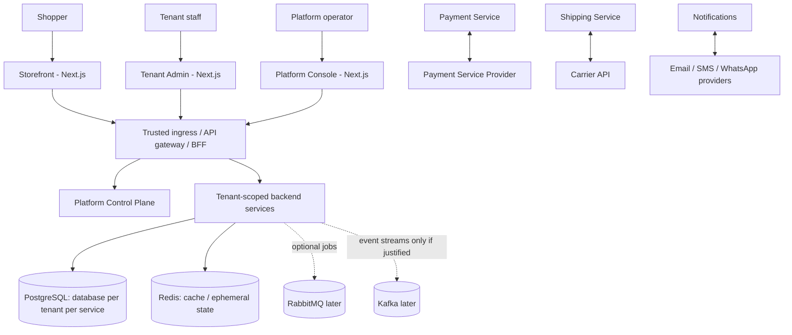

# Phase 0 Architecture Baseline

# Part A — Phase 0 Architecture Baseline

## 1. Executive decision

Build a generic white-label, multi-tenant commerce SaaS platform. A new business is onboarded through platform configuration, not a code fork. Each tenant receives its own brand, domain, products, customer accounts, orders, inventory, business settings, payment-provider configuration and staff access. The platform operator has a separate control plane.

The repository is a monorepo with **separate `frontend/` and `backend/` roots**. The three frontend applications are independently runnable apps. Each backend microservice is an independently structured application with its own dependencies, lockfile, migrations, database credentials, tests, Dockerfile and release boundary. Shared code is limited to versioned contracts and small technical libraries; domain models and database repositories are never shared across service boundaries.

Tenant commerce data uses **database-per-tenant-per-service**. Databases are provisioned lazily for enabled tenant/service pairs rather than pre-creating all 15 databases for every tenant. A single local PostgreSQL container may host many logical databases, but there is no shared tenant commerce database or cross-service SQL access. The control-plane database stores only platform metadata and provisioning references.

Initial local infrastructure is deliberately small: PostgreSQL, Redis and Mailpit. RabbitMQ is optional when a real background-job requirement arrives. Kafka is deferred until replayable/high-volume event streaming is justified by a reviewed ADR. No cloud resources or AI features are required for Phase 1A.

## 2. Goals, non-goals and actors

### Goals

- Onboard multiple businesses without separate codebases.
- Provide a premium responsive storefront, tenant-admin app and platform-console app.
- Isolate tenant data and tenant payment-provider credentials.
- Support a full commerce lifecycle: catalogue, pricing, inventory, cart, checkout, payment, order, fulfilment, returns and customer communications.
- Operate each backend service independently inside one monorepo.
- Keep local development reproducible and light enough to run only the required dependencies.
- Preserve a container/configuration boundary that can later be moved to EC2.
- Add RAG, product discovery and AI agents only after core commerce is stable and approved.

### Non-goals for initial local development

- Public multi-vendor marketplace or platform-operated split settlements.
- AI diagnosis, medical advice, prescriptions or autonomous medical claims.
- Mobile-native applications (responsive web first).
- Azure/cloud dependency, production hosting or public ingress.
- Storing raw card numbers, CVV/CVC, PIN or track data.
- A claim of zero vulnerabilities or automatic legal/PCI/regulatory compliance.

### Actors

| Actor | Scope |
|---|---|
| Shopper/customer | One tenant storefront and that tenant's customer identity |
| Tenant owner/admin/staff | One or more explicit tenant memberships and least-privilege roles |
| Platform operator | Tenant onboarding, plans, domain and provisioning lifecycle; no unrestricted business-data access by default |
| Platform security/operator admin | Platform-level identity, privileged audited actions and break-glass support controls |
| External PSP/carrier/communication provider | Narrow provider APIs and signed webhooks |

## 3. Selected technology baseline

Versions below are a reproducible starting baseline checked on 16 November 2026. Before implementation, review current patch releases and compatibility; commit lockfiles and image digests where practical. Do not use floating `latest` tags in the repository.

| Layer | Selected baseline | Rule |
|---|---|---|
| Frontend | Next.js App Router, React, TypeScript strict | Three separate apps; no business source-of-truth logic in UI |
| Frontend workspace | pnpm workspaces + Turborepo | Frontend-only workspace; pin actual package manager via `packageManager` and lockfile during scaffold |
| UI | Tailwind CSS, Radix/shadcn primitives, Motion | Accessible design system and tenant design tokens |
| Frontend data/forms | TanStack Query, React Hook Form, Zod | Use server components for read-heavy public pages where appropriate |
| Frontend test | Vitest, Testing Library, Playwright, Storybook | Unit, interaction, E2E and visual review |
| Backend | Python 3.14.10, FastAPI, Pydantic v2 | Python 3.14 bug-fix line; pin exact patch in `.python-version` and service image |
| Backend packages | SQLAlchemy 2, Psycopg 3, Alembic, `uv` | Each service owns its `pyproject.toml`, `uv.lock` and migrations |
| Backend quality | Pytest, Ruff, MyPy or Pyright | Strict typing, lint and tests in CI |
| Primary data | PostgreSQL 18.7 | Logical database per tenant per service; separate runtime/migrator credentials |
| Cache | Redis 8.10.3 | Cache/ephemeral state only, never authoritative price/order/payment/inventory data |
| Local email | Mailpit 1.33.1 | Capture SMTP locally; no real customer messages |
| Background jobs | RabbitMQ 4.4.0 optional Compose profile | Introduce only with a concrete queue consumer/retry requirement |
| Event streaming | Apache Kafka 4.4.0 later optional profile | Deferred; not the default local dependency or generic job queue |
| Local runtime | Docker Compose | Dependencies only initially; apps can run on host during service development |
| API contracts | REST/JSON + OpenAPI 3.1 | Version public APIs (e.g. `/api/v1`); internal contracts backward-compatible |
| Observability | Structured logs first; OpenTelemetry instrumentation planned | Never log PII, tokens, OTPs, PAN/CVV or provider secrets |

**Runtime policy:** use Node.js 26 Active LTS (26.x) and Python 3.14 bug-fix (3.14.x) as project baselines. Use the exact versions in `.nvmrc`/`.node-version`, `.python-version`, container build files and CI once the first app/service is scaffolded. Avoid preview/alpha runtimes for the initial product.

### Why this stack

Next.js provides server rendering and SEO support for product pages while TypeScript helps make the multi-app frontend maintainable. FastAPI/Pydantic fit the Python backend and later RAG/agent workloads without forcing AI code into commerce services. PostgreSQL is the transactional system of record. Redis is a performance/ephemeral layer. Compose keeps local dependencies reproducible. Service boundaries, not the language, provide independent ownership.

## 4. System context and application boundaries



### Frontend ownership

| App | Owns | Must not do |
|---|---|---|
| `frontend/apps/storefront` | Public catalogue, product pages, customer account UI, cart/checkout UI, order tracking | Connect to databases, calculate authoritative prices, decide stock, mark payments complete |
| `frontend/apps/tenant-admin` | Tenant products, inventory, orders, promotions, staff and configuration UI | Access another tenant, bypass backend policies or contain platform-super-admin privileges |
| `frontend/apps/platform-console` | Tenant onboarding/lifecycle, plans/entitlements, verified domains, provisioning status and platform operations | Read customer card data or directly mutate tenant-owned databases |

Shared frontend packages should contain neutral UI primitives, design tokens, typed generated API clients and test utilities only. Theme and brand data come from validated tenant configuration. Do not execute tenant-provided JavaScript or arbitrary CSS.

## 5. Service boundaries and data ownership

Every service has its own database per tenant where it owns tenant business data. The platform control-plane database is global and metadata-only. Platform-level operator identities belong to a platform-scoped identity database owned by Identity & Access, separate from tenant customer/staff identity databases.

| Service | Source-of-truth data | Explicitly does not own |
|---|---|---|
| Platform Control Plane | Tenant registry, domains, status, plans/entitlements, provisioning jobs and database/secret references | Tenant products, customers, carts, orders, payment transactions |
| Identity & Access | Platform operator identities in platform scope; customer/staff identities, credentials, sessions, memberships and consent per tenant | Products, orders, payment methods |
| Catalogue | Product master, categories, variants, attributes, product content and publication status | Prices, inventory, orders |
| Media | Asset metadata, ownership, processing state and safe storage references | Executable content or card images/data |
| Pricing & Promotions | Price lists, price rules, coupons and promotion evaluation | Product master, stock or payment transactions |
| Inventory | Warehouses, stock, batch/lot, expiry, movements, reservations | Order/payment source records |
| Cart | Guest/authenticated cart, cart lines and wishlist | Final order or payment status |
| Orders | Order aggregate, immutable line/tax/price snapshots, order state and cancellation/return references | Payment credentials or inventory source tables |
| Payment | PSP account references, payment intents/attempts, provider event inbox, refunds and reconciliation | Raw PAN/CVV or order master |
| Checkout Orchestrator | Checkout quote snapshot, saga state, idempotency and cross-service workflow | Product/inventory source tables or card data |
| Shipping & Fulfilment | Shipment, label reference, tracking and delivery state | Full order source of truth |
| Notifications | Templates, consent/preferences references, delivery attempts and provider adapters | Passwords/auth secrets or payment credentials |
| Search & Discovery | Derived tenant search documents/index metadata | Authoritative product records |
| Reviews & Content | Reviews, ratings, Q&A and moderation state | Identity credentials or order source tables |
| Analytics & Reporting | Minimized, derived reporting data | Authoritative commerce state |

A service may store a minimal immutable snapshot or external reference needed for its own aggregate. Cross-service IDs are references, not relational foreign keys into another service's database. There are no cross-database SQL joins, shared ORM entities or direct cross-service DB reads/writes.

## 6. Tenant resolution and authorization

Tenant context and user authorization are distinct. Knowing a tenant does not grant a user access to that tenant.

1. A trusted ingress terminates the client connection and normalizes the host. It strips client-supplied forwarding/tenant headers and writes its own trusted routing metadata.
2. The host is normalized and matched against an active, verified `tenant_domains` record. New custom domains require a domain-ownership challenge (DNS TXT or an equally strong documented method) before activation.
3. The platform control plane checks tenant lifecycle state and returns a short-lived signed tenant context to trusted backend components. The browser never receives a signing key.
4. Internal tenant context is signed asymmetrically and includes at minimum issuer, audience, tenant opaque ID, normalized domain, issued-at, expiry, key ID and correlation ID. Services verify signature, issuer, audience, expiry and tenant status. Keys support rotation and overlap.
5. Service-to-service caller identity is authenticated separately (short-lived audience-specific service credentials; mTLS is a production hardening option). A tenant-context token is not a substitute for service authentication.
6. Identity & Access verifies user authentication, tenant membership, role/permission and object-level authorization on every protected operation.
7. The service resolves only its own database location and secret reference for `(service_id, tenant_id)` and creates a tenant-scoped DB session.
8. Unknown, unverified, suspended, provisioning, offboarding or failed tenants are denied by default.

**Never trust** browser-provided `tenant_id`, `X-Tenant-ID`, URL path values or request body fields to choose a database or confer authorization. A host name is routing input, not proof of user membership.

## 7. Database-per-tenant-per-service operating model

### Topology

```text
PostgreSQL cluster (one local container; production placement is a later ADR)
|
+-- platform_control                         # global SaaS metadata only
|
+-- identity_platform                        # platform operator identities (Identity service)
|
+-- Tenant 01 (opaque ID; illustration only)
|   +-- tenant_01_catalogue                  # Catalogue service database
|   +-- tenant_01_inventory                  # Inventory service database
|   +-- tenant_01_orders                     # Orders service database
|   +-- tenant_01_payment                    # Payment service database
|   +-- ...                                  # only enabled service/tenant pairs
|
+-- Tenant 02 (opaque ID; illustration only)
    +-- tenant_02_catalogue
    +-- tenant_02_inventory
    +-- tenant_02_orders
    +-- tenant_02_payment
    +-- ...
```


The above is illustrative. Physical host/cluster placement can be separated by service/tenant at a later scale or compliance tier. Logical database separation is mandatory for the initial architecture.

### Provisioning and roles

- Provision a database per tenant/service pair using an opaque tenant ID. Never derive SQL identifiers from tenant display names or unsanitized slugs. Respect PostgreSQL's 63-byte identifier limit.
- Each database has distinct migrator/owner and runtime roles. Runtime roles are not owners, superusers, `CREATEDB` or `CREATEROLE`. Role names are generated from opaque IDs and kept within PostgreSQL's 63-byte identifier limit.
- A separate provisioning worker has a narrowly controlled provisioning credential for database/role creation, plus a distinct low-privilege Control Plane worker credential for reading/updating provisioning jobs. The normal HTTP API receives neither credential. Neither the worker nor API receives the bootstrap superuser credential.
- Immediately after creating each tenant/service database, the provisioner revokes `CONNECT` and `TEMPORARY` from `PUBLIC`, then grants `CONNECT` only to that database's service-specific migrator and runtime roles. The owning service's initial migration revokes public schema access, grants only required schema usage, and establishes default table/sequence privileges for its runtime role. A service may connect only to its own tenant databases. A Catalogue credential cannot connect to Inventory or Orders databases.
- Control-plane metadata stores database name/placement and a `secret_ref`, never the plaintext database password.
- Local development uses a dedicated local secret adapter/file outside source control with restrictive OS permissions. The adapter exposes opaque `secret_ref` values; plaintext tenant DB passwords are never written to the Control Plane database or logs. Production will use a production secret manager adapter selected in a future hosting ADR.
- Provisioning is an idempotent state machine (requested -> database created -> roles created -> secret references stored -> migration pending -> owning-service migration completed -> smoke test passed -> ready). Failed steps are retriable and observable; incomplete tenants remain disabled.
- The privileged provisioning worker creates databases and least-privilege roles and stores generated credentials through a secret-store adapter. It does **not** execute another service's migrations. Each owning service runs its own migration job using its own migrator credential and migration history. The Control Plane records migration status through a narrowly scoped worker/control-plane contract. This preserves independent service releases and prevents the Control Plane from becoming a migration runner for every service.
- Backup, restore, export, retention and deletion must be tenant/service-scoped, audited and tested before production.

### Connection management

Database-per-tenant can create an unbounded pool problem if every tenant gets a permanent SQLAlchemy engine in every process. Use a bounded, lazy tenant database pool registry per service process. Define per-tenant pool caps, global pool caps, idle eviction, acquisition timeouts, statement timeouts and a total PostgreSQL connection budget. Never share an ORM session/transaction between tenants. Evaluate PgBouncer only after load/concurrency tests and verify compatibility with prepared statements, transaction pooling and the selected driver.

### Tenant ID columns

Tenant IDs may be retained on records for audit, reconciliation and defense-in-depth. Because the database itself is tenant-specific, a tenant predicate on every SQL query is not the primary isolation boundary and must not be represented as mandatory duplicate filtering everywhere. Database routing, per-database roles, request context, object authorization and negative isolation tests are the controls. Any tenant column still present must match the active tenant context.

## 8. Service communication and events

- Use synchronous REST/JSON + OpenAPI for bounded request/response operations with explicit deadlines, timeouts and safe retry rules.
- Use versioned domain events for decoupled side effects and workflows. Events include event ID, event type/version, tenant opaque ID, aggregate ID, occurrence time, correlation/causation IDs and schema version. Do not include PAN/CVV, credentials, OTP, access tokens or unnecessary PII.
- Implement the transactional outbox in the same database transaction as the owning service's state change. Publish after commit; consumers use an inbox/deduplication record and are idempotent.
- Do not use distributed SQL transactions. Use durable saga/orchestration state and compensating actions where required.
- Initial local foundation does not need a broker. Start with the smallest synchronous/API and outbox design needed by the first service. Add RabbitMQ for competing background jobs/retries if required. Add Kafka only for replayable/high-volume event streams, multiple consumers, retention or stream processing needs.
- Kafka topic/partition keys do not create tenant security. Tenant authorization, ACLs, quotas, schema validation and consumer enforcement must be separately designed.

## 9. Checkout, orders and payment saga

The older draft's sequence that created an order only after payment is rejected. Persist a pending order before sending the shopper to the PSP so a successful payment can always be reconciled to a durable order reference.

### Happy path

1. Storefront submits a checkout attempt with an idempotency key; backend resolves tenant and customer/guest permissions.
2. Checkout validates cart ownership, active product/variant, current price, coupon eligibility, tax and delivery options. Browser totals are never authoritative.
3. Inventory atomically reserves requested stock with an expiry and returns a reservation reference. Reservation is tenant/database scoped and concurrency-tested.
4. Pricing/Checkout calculates the final quote and freezes line, price, discount, tax, shipping, currency and total snapshots with a quote expiry.
5. Orders creates a durable `PENDING_PAYMENT` order idempotently using the quote snapshot and reservation reference. It returns the stable order ID.
6. Payment creates a provider payment intent/session for the exact amount/currency/order reference using an idempotency key, and returns a PSP-hosted checkout URL/token.
7. Customer enters payment details only on the PSP-hosted page/fields. PAN/CVV never reach the platform.
8. PSP webhook arrives at Payment. Payment validates the exact provider signature scheme over the required raw body, event identity, merchant/account, amount, currency and mapped payment reference. It records the provider event idempotently and reconciles server-to-server where appropriate.
9. Payment persists the verified state and publishes `PaymentAuthorized/PaymentCaptured` only after its transaction commits (via outbox).
10. Checkout saga resumes: Orders transitions from `PENDING_PAYMENT` to the appropriate confirmed/paid state; Inventory commits the reservation; the workflow requests fulfilment and notifications.
11. The browser return URL is a user-experience signal only. It must fetch authoritative order/payment status from the backend.

### Failure/compensation

| Failure | Required behavior |
|---|---|
| Price changed/stock unavailable before order | Requote or reject; no payment session created |
| Payment fails/cancelled/times out | Mark payment/order attempt failed or expired; release reservation; allow a new idempotent attempt |
| Webhook duplicated/replayed/out-of-order | Verify, deduplicate and apply allowed state transition only; reconcile unknown states |
| Payment succeeds but Orders update is unavailable | Keep durable saga pending; retry with bounded exponential backoff; alert; reconcile; do not tell the customer payment failed merely because of a transient service error |
| Reservation expires before successful payment | Attempt safe re-reservation if business rules permit; otherwise void/refund payment and enter manual reconciliation |
| Payment succeeds but inventory commit fails | Retry and reconcile reservation; if fulfillment cannot be guaranteed, initiate void/refund and manual review |
| Refund/void provider call fails | Keep refund state pending, retry idempotently, alert operations; never mark refunded before provider confirms |

No distributed DB transaction is held open while calling a PSP/carrier. Every state transition has an idempotency key, durable attempt record, correlation ID, timeout, retry/compensation action and operator-visible reconciliation state. The concrete authorization/capture/void behavior is PSP-specific and remains behind a provider adapter.

## 10. Payment boundary and masking

- Use a PSP-hosted checkout or provider-hosted fields/tokenized components so card entry is handled directly by the PSP.
- The application must not define request fields or endpoints for full PAN, CVV/CVC, PIN or track data.
- Never store CVV/CVC after authorization, even encrypted. Never store raw PAN. Do not log payment form bodies or unredacted provider payloads.
- Save only provider reference/token where needed and protected, payment status, amount/currency, timestamps, brand and last four digits where the provider returns and permits them.
- The UI renders safe metadata such as `Visa •••• 4242`; masking is not a reason to receive or store full card data.
- Tenant PSP merchant credentials are tenant-specific and encrypted/secrets-managed; never share them across tenants.
- Customer payment processing for a tenant is separate from the platform's own SaaS subscription billing.
- Webhooks are signed, deduplicated, replay-aware and reconciled. Browser redirects never set `PAID`.
- Hosted checkout reduces but does not eliminate PCI responsibilities. Confirm scope with PSP/acquirer and qualified assessor before live payments.

## 11. Identity and account model

- Platform operators and break-glass support principals use platform scope, separate from tenant customer accounts.
- Customer and tenant staff identities are tenant scoped. Same email/phone may be used at two different stores; by default these are separate tenant identities and sessions.
- Explicit account linking or social login uses OIDC and a verified subject/issuer mapping; do not silently merge accounts by matching email alone.
- Support access to a tenant is time-bound, reason-coded, least-privilege, approved and audited. No hidden cross-tenant impersonation.
- Use OIDC Authorization Code + PKCE S256, strict redirect allowlists, state/nonce and issuer/audience/signature checks. Passwords use Argon2id. OTPs are random, hashed, short-lived, single-use, attempt-limited and never logged.
- Prefer server-managed sessions using Secure, HttpOnly, SameSite cookies; CSRF protection for state-changing cookie-authenticated requests. Refresh/session tokens rotate and can be revoked. Admins require MFA and step-up for sensitive actions.

## 12. Security and quality baseline

Security is designed and verified throughout; no document can promise an absence of vulnerabilities. Use OWASP ASVS 5.0 as a verification checklist and OWASP API Security Top 10 as an API threat reference, then add product-specific controls.

| Boundary | Required controls and evidence |
|---|---|
| Tenant isolation | Two-tenant negative read/write tests for every service; `PUBLIC` cannot connect to tenant DBs; only that DB's runtime/migrator roles can connect; forged host/header/body tenant tests; credential-denial tests; pool isolation; suspended/unprovisioned tenant rejection |
| Authentication/authorization | Login/OTP abuse tests, session rotation/revocation, CSRF, OAuth state/nonce, MFA for admins, object/function/property-level authorization and IDOR/BOLA tests |
| Payment | PSP-hosted input, schema/log/cache/event scan for prohibited card data, signed webhook tests, idempotency/replay/out-of-order tests and reconciliation drills |
| API | Input validation, safe pagination, resource limits, rate limiting, timeouts, allowlisted CORS, CSP/security headers, safe error responses |
| Media/uploads | Size limits, content/MIME sniffing, image decode/re-encode where appropriate, non-executable object storage, signed tenant-scoped references, malware scanning where available |
| Events/queues | Producer/consumer identity, schema validation, tenant authorization, idempotent consumer, bounded retries, dead-letter handling and PII/secret scrubbing |
| Secrets | No secrets in Git; local `.env` ignored; secret scanning; short-lived/rotatable credentials; least-privilege access; redact secrets from logs/traces/exceptions |
| Supply chain | Lockfiles, pinned images, vulnerability scans, SBOM, signed release artifacts where practical, review transitive/high-risk dependencies |
| Admin operations | RBAC, audit log, step-up authentication, time-boxed support access, two-person approval for destructive/high-risk actions where appropriate |
| Availability | Request/connection limits, backpressure, bounded queues/pools, timeouts, cache stampede control, dependency health checks and graceful degradation |

### Definition of done for every service

- Unit, integration, contract, security and tenant-isolation tests relevant to that service pass.
- Migration is repeatable and tested against an empty database and an upgrade path.
- Health, readiness, graceful shutdown, structured logs and correlation IDs exist.
- Dependencies and container image are pinned; image runs non-root where feasible and has no secret baked into layers.
- API/event contracts and errors are documented.
- Failure/retry/idempotency paths are tested.
- No raw card data, credentials, OTPs or access tokens in logs/events/traces.
- Agent reports exact commands, actual results, remaining risks and code explanation. Human approval is required to continue.

## 13. Local development and EC2 portability

### Local

Default Compose dependencies: PostgreSQL 18.7, Redis 8.10.3, Mailpit 1.33.1. Host ports bind to `127.0.0.1`. Passwords are generated by `scripts/bootstrap_local.py` into a Git-ignored `.env`; they are not printed. PostgreSQL creates distinct bootstrap, runtime, migrator, Control Plane worker and local database-provisioner identities. The bootstrap admin and provisioning credential are never given to application services. RabbitMQ 4.4.0 is an opt-in `messaging` profile. Kafka is not part of the Phase 1A stack.

Local app code can run on the host during development; do not containerize every microservice at the start. Each service gets a Dockerfile when that service is scaffolded. Only start the service and dependencies needed for the current bounded task.

### EC2 later

The portability target is OCI container images plus externalized configuration, not a promise that local Compose is itself a highly available production platform.

- Build the same service Dockerfiles as immutable images; do not use development bind mounts or dev servers in production.
- Run non-root, read-only where feasible, drop capabilities, use health/readiness checks, resource limits and graceful termination.
- Inject configuration separately from images. Use AWS IAM roles and a production secret manager; never bake secrets into images or AMIs.
- Use private subnets where practical, restrictive security groups, SSM Session Manager rather than open SSH where possible, IMDSv2 and TLS termination at a reviewed ingress/reverse proxy.
- Persist PostgreSQL on durable storage with automated encrypted backups and tested restore/PITR. Do not store authoritative data in container writable layers.
- Move media to durable object storage; local filesystem is only a development adapter.
- Add log aggregation, metrics, tracing, alerts, patching and incident runbooks.
- A single EC2 host with Docker Compose is a **pilot/small deployment**, with a host-level failure domain and maintenance downtime. It is not high availability. Multi-AZ database, multiple app instances, load balancing and automated failover require a separate AWS deployment architecture and operational budget.

No EC2 resource is created in this project phase. The final hosting ADR must choose the deployment target based on tenant count, recovery objectives, cost and operational capacity.

## 14. Service implementation sequence and gates

Implement one service at a time, in this dependency order. Work on a service only when its entry criteria are met and its upstream contracts are accepted.

| Order | Service | Entry/dependency | Minimum exit proof |
|---:|---|---|---|
| 1 | Platform Control Plane | Local foundation and ADR-001/003/015 | Tenant lifecycle + two-tenant DB provisioning; unverified/suspended denied; metadata-only control DB; recoverable/idempotent provisioning |
| 2 | Identity & Access | Control-plane tenant context/provisioning contract | Tenant/platform identities separated; secure login/OIDC/OTP/session; negative cross-tenant and account-link tests |
| 3 | Catalogue | Tenant resolver + identity/admin contracts | Independent tenant catalogues, product/variant workflow, API contract and isolation tests |
| 4 | Media | Tenant authorization and asset contract | Safe uploads, tenant-scoped paths/metadata, allowed file types, safe retrieval |
| 5 | Pricing & Promotions | Catalogue contract | Deterministic pricing/coupon, price snapshots and tamper tests |
| 6 | Inventory | Catalogue SKU/variant contract | Atomic stock updates/reservations, batch/expiry support, concurrent oversell tests |
| 7 | Cart | Identity, Catalogue, Pricing, Inventory contracts | Guest/auth cart, merge, wishlist, persistence and tenant tests |
| 8 | Orders | Accepted cart/quote contracts | Pending order, immutable snapshots, state machine, idempotent operations |
| 9 | Payment | Order reference + provider adapter decisions | Hosted sandbox flow, signed webhook, no PAN/CVV, refund/reconciliation tests |
| 10 | Checkout Orchestrator | Cart, Pricing, Inventory, Orders, Payment contracts | Durable saga happy path, retry, timeout, compensation and manual reconciliation tests |
| 11 | Shipping & Fulfilment | Confirmed order contract | Label/tracking adapters, cancellations/returns and idempotent webhooks |
| 12 | Notifications | Approved domain events and consent model | Template/provider adapter, retry/suppression, Mailpit local proof |
| 13 | Search & Discovery | Catalogue events/contract | Rebuildable derived index, tenant isolation and query abuse tests |
| 14 | Reviews & Content | Identity and order verification contract | Verified-purchase review, moderation and abuse tests |
| 15 | Analytics & Reporting | Stable source events and privacy model | Derived/minimized tenant reports, authorization and data-retention tests |

The order of frontend work is separate: foundation/design tokens -> platform console against control-plane contract -> storefront tenant-aware shell -> tenant admin shell -> customer journeys against stable APIs. Do not ask an agent to implement all 15 services or all three apps in one prompt.

## 15. Phase boundaries

- **Phase 0 (this document):** architecture baseline and open-decision register complete; no production code is authorized by this document alone.
- **Phase 1A:** local developer foundation (Docker Compose dependencies, generated local secrets, connection/health checks and runbooks). This starter pack provides the files; user runs them locally.
- **Phase 1B:** implement Platform Control Plane only, service by service and with human gate.
- **Phase 2+:** identity, storefront/admin, commerce services in the agreed dependency order.
- **Later:** AI integration after core commerce acceptance.
- **Final:** hosting/EC2 deployment after deployment architecture and operations review.

## 16. Unresolved business and compliance decisions

These are not silently assumed and do not prevent starting the local development environment or control-plane foundation. They must be resolved before the affected production feature is enabled.

| Decision | Current provisional position | Required before |
|---|---|---|
| Merchant of record / seller | Each tenant is assumed to be the seller and to connect its own PSP account; no platform split settlement | Production payments / contracts |
| PSP provider | Provider adapter + sandbox first; final India PSP selection open | Live payments |
| Product eligibility | Tenant-specific category and jurisdiction rules; restricted products fail closed | Any regulated product sale |
| Tax | Store tax configuration and immutable quote tax snapshots; calculation adapter/jurisdiction owner open | Real checkout |
| Privacy/retention | Minimize data; retention/legal hold and deletion periods need jurisdiction review | Customer production data |
| SaaS subscription billing | Separate bounded context from customer product payment; pricing/plan model open | Commercial SaaS billing |
| Scale/SLO | Tenant-count, concurrency, RPO/RTO and budget targets not yet supplied | Production capacity plan |
| EC2 topology | Single EC2 is pilot only; HA topology and managed DB/object storage strategy open | Public production deployment |

## 17. Phase 0 exit checklist

- [x] Generic SaaS product identity and initial scope documented.
- [x] Separate frontend/backend monorepo boundaries documented.
- [x] Service ownership and dependency order documented.
- [x] Database-per-tenant-per-service model and provisioning controls documented.
- [x] Tenant resolution and service/user authorization separated.
- [x] Payment boundary and corrected checkout saga documented.
- [x] Security verification baseline and service Definition of Done documented.
- [x] Local-first and EC2 portability boundary documented.
- [x] Service-by-service implementation gates documented.
- [x] Open business/legal/operational decisions explicitly registered.
- [ ] Human review and approval of this baseline.

**Phase 0 technical baseline is complete.** This is an implementation-ready baseline for local Phase 1A/1B, not a claim of production readiness. The unchecked human approval and open business/compliance decisions remain visible; they must not be marked complete by an AI agent.
---
